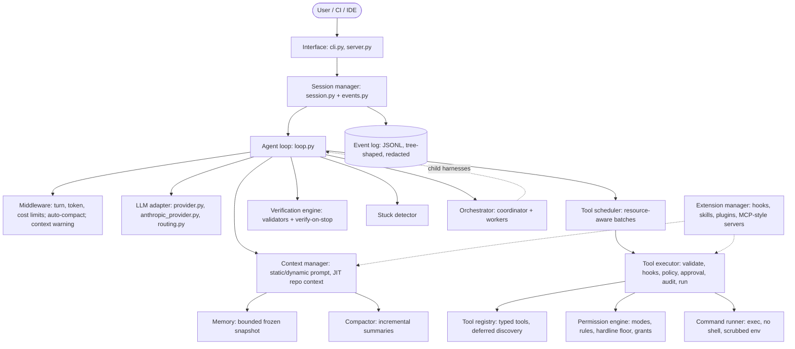
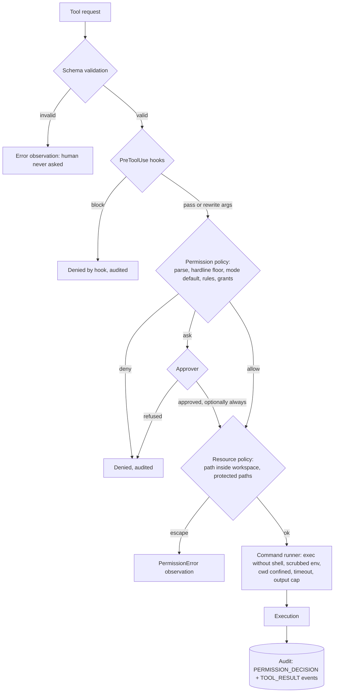

<div align="center">


# Harness Engineering

**Inside the runtime of production coding agents, and how to build one.**

Companion material for the article *"Harness Engineering: Inside the Runtime of Production Coding Agents (and How to Build One)"*:
36 Mermaid diagrams and a small, fully tested reference harness in pure-stdlib Python.

[](https://www.python.org/)
[](#how-to-run)
[](#how-to-run)
[](diagrams.md)
[](https://arxiv.org/abs/2609.00006)
[](#with-a-real-model-optional)

[What's inside](#whats-inside) •
[Architecture](#architecture) •
[How to run](#how-to-run) •
[Relationship to the paper](#relationship-to-the-paper) •
[Known limitations](#known-limitations-read-before-reusing)

</div>

---

## What's inside

| Deliverable | Location |
|---|---|
| 📝 **Article** | Lives in the site repository at `_implementations/harness-engineering.md` and is published at `/engineering/harness-engineering/` (Engineering Implementations → AI Agents → Agent Infrastructure). It is **not** included in this folder. |
| 🗺️ **All Mermaid diagrams, by section** | [`diagrams.md`](diagrams.md): 36 diagrams generated from the article (30 flowcharts, 5 sequence diagrams, 1 state diagram) |
| 🛠️ **Reference implementation** | [`reference-harness/`](reference-harness/) |

> In the site repository this folder is listed under `exclude:` in `_config.yml`, so Jekyll does not publish it.

<table>
<tr>
<td align="center"><b>7</b><br><sub>subsystems</sub></td>
<td align="center"><b>11</b><br><sub>production harnesses studied</sub></td>
<td align="center"><b>36</b><br><sub>diagrams</sub></td>
<td align="center"><b>79</b><br><sub>tests</sub></td>
<td align="center"><b>0</b><br><sub>third-party deps (core)</sub></td>
</tr>
</table>

## What this project demonstrates

A small, stdlib-only Python **agent harness** in which every subsystem from the paper's anatomy is a separate, tested module:

- 🔁 **Agent loop**: owns only ordering and stop conditions.
- 🧰 **Typed tool registry**: validation, permission and concurrency metadata, and declared resource scopes.
- ⚡ **Concurrency-aware scheduler**: order-preserving batches, results returned in request order.
- 🛡️ **Policy engine**: modes, self-testing rules, a hardline floor that survives YOLO, and arity-scoped grants.
- ✅ **Verification engine**: a verify-on-stop guard that reports `unverified` instead of success when it gives up.
- 📜 **Event log**: append-only, tree-shaped and redacted, with replay and fork.
- 🧠 **Context management**: a cache-stable prompt, JIT `AGENTS.md`/`CLAUDE.md`, compaction with incremental summaries, bounded memory.
- 🤝 **Orchestration**: a depth-limited coordinator–worker orchestrator with a per-run worker cap.
- 🔌 **Extensibility**: hooks, skills, plugins, MCP-style tool servers, deferred tool discovery.

## Architecture

The reference harness at a glance (diagram 22 in [`diagrams.md`](diagrams.md)):



<details>
<summary><b>Every tool call goes through the safety pipeline</b> (diagram 25)</summary>



</details>

<details>
<summary><b>Project layout</b></summary>

```text
harness_engineering/
├── README.md
├── diagrams.md                 # all 36 Mermaid diagrams, in article order
├── assets/logo.svg
└── reference-harness/
    ├── harness/
    │   ├── app.py              # composition root: build_harness()
    │   ├── core/               # loop, middleware, session, state, events, stuck detection
    │   ├── llm/                # Model protocol, Anthropic adapter, routing, streaming guards
    │   ├── tools/              # registry, scheduler, executor, permissions, built-in tools
    │   ├── safety/             # policy engine, approval, command runner, untrusted content
    │   ├── context/            # context manager, compaction, memory, AGENTS.md loading
    │   ├── verification/       # validators, verify-on-stop, reflection feedback
    │   ├── orchestration/      # coordinator, workers, agent specs
    │   ├── extensions/         # hooks, skills, plugins, MCP-style tool servers
    │   └── interface/          # CLI (run / replay / tree) and HTTP server
    ├── examples/               # minimal_loop.py, demo_bugfix.py
    └── tests/                  # 79 unittest cases
```

</details>

## How to run

**Requirements:** Python 3.10+ (developed and tested on 3.13). No third-party packages for the core.

```bash
cd harness_engineering/reference-harness

# 79 tests: scheduler, safety pipeline, loop guards, verify-on-stop, compaction,
# event-log replay/fork/redaction, deferred tools, sub-agents, skills, MCP-style tools,
# server, and the hardening regressions in tests/test_hardening.py
python -m unittest discover -s tests -v

# Step 1 of the article: the ~30-line minimal loop with a scripted model
python examples/minimal_loop.py

# End-to-end scripted demo (no API key): parallel reads, JIT context,
# a premature "done" vetoed by verify-on-stop, policy decisions, fork
python examples/demo_bugfix.py

# Inspect any session log
python -m harness.interface.cli replay <workspace>/.harness/sessions/<id>.jsonl
python -m harness.interface.cli tree   <workspace>/.harness/sessions/<id>.jsonl
```

### With a real model (optional)

Run `pip install anthropic`, with credentials in the environment:

```bash
python -m harness.interface.cli run --workspace /path/to/repo \
    --task "Fix the failing test in tests/test_parser.py" \
    --mode default --verify "python -m unittest -q"
```

`run` uses `llm/anthropic_provider.py`, which targets `claude-opus-5-5`. The adapter:

- uses adaptive thinking;
- puts a cache breakpoint on the static system prefix;
- enables server-side refusal fallback (`fallbacks="default"`);
- replays raw assistant blocks unchanged;
- turns "prompt is too long" errors into a compaction.

In DEFAULT mode, writes and commands are approved interactively in the terminal.

## Relationship to the paper

The primary source is *Harness Engineering: Anatomy, Architecture, and Evolution of Coding Agents — A Source-Code Study of Eleven Systems* (Barbaste, Darrigol, Vu, Wiltberger; [arXiv:2609.00006](https://arxiv.org/abs/2609.00006), July 2026). The paper describes how eleven production coding harnesses are built. **It ships no code for this project, and this project contains no code from any studied system.** Each module here is an independent implementation of a mechanism the paper documents, and every module's docstring names which one.

### Directly inspired by observed mechanisms

| Module | Mechanism observed in the paper | Systems (per the paper) |
|---|---|---|
| `core/loop.py` | linear action–observation loop | Mini-SWE-Agent (§6.2) |
| `core/middleware.py` | turn-level middleware pipeline | Mistral Vibe (§6.2) |
| `core/state.py` `IterationBudget` + grace turn | budgeted loop with final grace call | Hermes (§6.2) |
| `core/stuck.py` | SHA-256 call signatures; warn on repeated failures; hard cap | Hermes, Gemini CLI (§6.2) |
| `core/events.py` | persistent event log, tree with movable head, redaction | OpenHands (§6.2), Pi (§9.5) |
| `llm/streaming.py` truncation guard | fail all tool calls of a length-truncated message | Pi (§6.2) |
| `llm/routing.py` | strategy-chain model router | Gemini CLI (§7.1) |
| `llm/provider.py` `SystemPrompt` | static/dynamic cache boundary | Claude Code, OpenHands (§7.2) |
| `tools/registry.py` `concurrency_safe=False` default | opt-in concurrency safety | Claude Code (§6.2) |
| `tools/registry.py` `Access` | declared resources, same-resource calls serialize | OpenHands (§6.2), Hermes (§6.2) |
| `tools/registry.py` `search` | deferred tools, `select:` + BM25 | Claude Code, Codex, Hermes (§8.3) |
| `tools/scheduler.py` `policy="boolean"` | consecutive-safe partition, max 10 concurrent | Claude Code (Table 18) |
| `wait_for_previous` | model-visible serialization knob | Gemini CLI (§6.2) |
| `tools/builtins/fs.py` | exact unique-substring edits; not-found vs ambiguous errors | Claude Code, Mistral Vibe, OpenCode (§8.4) |
| `safety/policy.py` rules with `match`/`not_match` | policy-as-code with parse-time-validated examples | Codex (§10.2) |
| `safety/policy.py` modes | PLAN / DEFAULT / AUTO_EDIT / YOLO | Gemini CLI (§10.5) |
| `safety/policy.py` hardline floor, frozen engine | floor survives `--yolo`; flag frozen at import | Hermes (§10.7) |
| `safety/policy.py` `grant_key` | arity-scoped "always allow" grants | OpenCode (§10.9) |
| `safety/sandbox.py` env scrubbing, `bubblewrap_argv` | credential scrubbing; Bubblewrap flags | Gemini CLI (§8.5), Codex (§10.2) |
| `safety/untrusted.py` | injection scanning; untrusted-content delimiters | Hermes, OpenHands (§10.3, §10.7) |
| `context/repo_context.py` | hierarchical context files, JIT nested attach | Codex, Mistral Vibe, OpenCode, Hermes, Gemini CLI (§9.7) |
| `context/compaction.py` | threshold compaction, incremental merge, task re-injection | Claude Code, Pi, OpenCode, Mistral Vibe (§9.5) |
| `context/memory.py` | bounded frozen-snapshot memory | Hermes (§9.6) |
| `verification/engine.py` `VerifyOnStop` | verify-on-stop guard | Hermes (§6.2) |
| `verification/reflection.py` | lint/compile feedback with code locality | Aider (§6.3) |
| `orchestration/worker.py` | fork modes + filtered inheritance; linked abort; tool intersection | Codex, Claude Code, Hermes (§11) |
| `extensions/hooks.py` | Claude Code hook vocabulary | Claude Code, Codex (§10.2) |
| `extensions/skills.py` | SKILL.md, progressive disclosure, `paths` activation, `requires` gating | 9 systems; Claude Code, OpenHands, OpenClaw (§12.5) |
| `extensions/plugins.py` | namespaced, deferred, scanned MCP tools | Mistral Vibe, Codex, Hermes (§8.3, §12) |
| `interface/server.py` | client/server harness; clients replay the persisted stream | OpenCode (§7.4, §14.1) |

### Proposed implementations (my design choices, not observed anywhere as-is)

- **The resource-aware scheduler** (`policy="resource"`): a single order-preserving pass that combines Claude Code's safe-by-default flag with OpenHands-style resource scopes, so disjoint writes can share a batch and no call overtakes a conflicting predecessor. Read-only sub-agents declare a read of the whole workspace, so they run in parallel with each other but never alongside a write.
- **The two-mode verify-on-stop.** With validators configured, the harness runs them, which is Aider-style evidence at Hermes' position. Without validators it falls back to Hermes' rule. Both use a logical clock for freshness and report `unverified` on give-up.
- **Policy composition.** Rules can tighten anything but relax only ASK, so PLAN stays read-only even with allow rules present. An ASK rule beats an ALLOW rule regardless of rule order. Path rules are matched against the resolved, case-folded workspace path, not the spelling the model used.
- **A hardline floor that normalizes before matching.** `/bin/rm`, `RM.EXE` and `rm` are the same program to the floor, and it looks through wrappers such as `env`, `nice` and `timeout`.
- **Audit events** that record both the policy verdict and the human answer.
- **The `AgentSpec` built-ins** (explorer, implementer, verifier), `stricter()` mode inheritance, the `run_phases()` deterministic pipeline, and a per-run worker cap shared by every depth.
- **Fail-closed hooks.** A crashing `PreToolUse` hook blocks the call. A crash in any other hook is skipped rather than ending the run.
- **The composition root** (`app.py`) and every concrete default value not given in the paper.

## Known limitations (read before reusing)

> [!WARNING]
> **`CommandRunner` is process hygiene, not a security boundary.** It uses exec without a shell, confines `cwd`, scrubs credential-like env vars by *name*, enforces a timeout, and kills the child when the call is cancelled. For untrusted workloads use an OS sandbox or a container. `bubblewrap_argv()` is unit-tested for argv construction only; it was not executed (developed on Windows). On Windows, killing a timed-out command does not kill its grandchildren. A value such as `DATABASE_URL=postgres://user:pass@…` is not scrubbed, because its name looks harmless.

- **The Anthropic adapter has not been run against the live API** in this project. Its message conversion is unit-tested with fixtures. Current Claude models check replayed thinking blocks against the history that produced them, and several things here change that history:
  - the reference compaction *replaces* older turns while keeping a verbatim tail;
  - `tool_search` grows the tool list mid-session;
  - the dynamic prompt's date changes at midnight;
  - the secret redactor rewrites stored assistant blocks.

  For long sessions on those models, prefer an append-only history strategy or the API's server-side compaction, and test.
- **Sub-agent spending is not charged to the parent.** Each worker gets its own turn, token and cost budget. A parent with `max_cost_usd=1.0` that spawns several workers can spend more than $1 in total. The worker cap bounds how many workers run, not what they spend.
- **The token estimate is conservative.** It counts assistant turns' raw blocks as well as their text, so compaction and the context warning fire earlier than necessary.
- **File tools do synchronous I/O.** A pathological regex in `grep` cannot be interrupted by the tool timeout, and "parallel" read batches don't truly overlap on disk.
- **In validator-free (Hermes) mode, any successful command counts as verification evidence**, including `git status`.
- **There is no automatic resume command.** The log contains everything needed to resume, but only replay/tree inspection ships.
- **The MCP adapter uses an in-process `ToolServer` stand-in**, not a real MCP client.
- **The injection pattern list is illustrative.** Delimiting and scanning reduce risk; they don't eliminate it.
- **Sub-agents share the parent's workspace.** The scheduler runs write-capable workers (implementer, verifier) one at a time, and never runs a read-only worker alongside a write. For truly concurrent writers, add per-worker git worktrees.

<div align="center">
<sub>Built as a companion to the article. Every mechanism is attributed to the system that inspired it; every design choice that isn't is labelled as mine.</sub>
</div>
